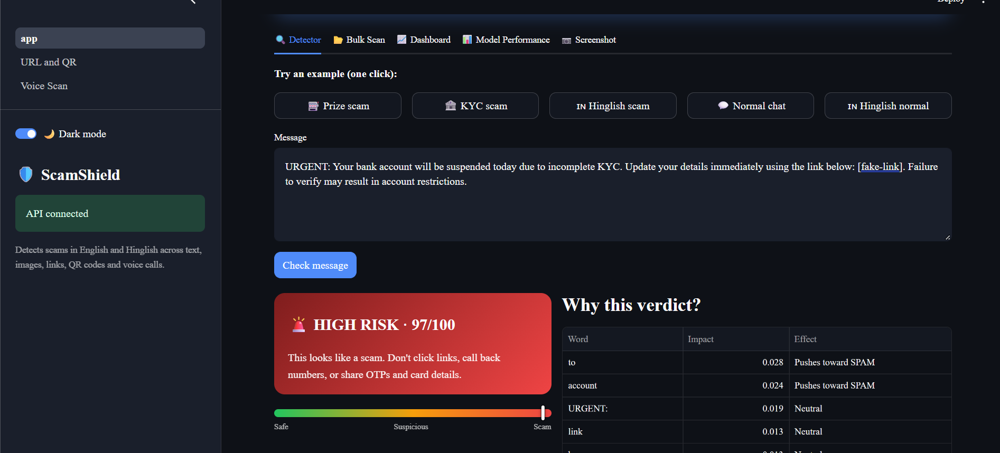
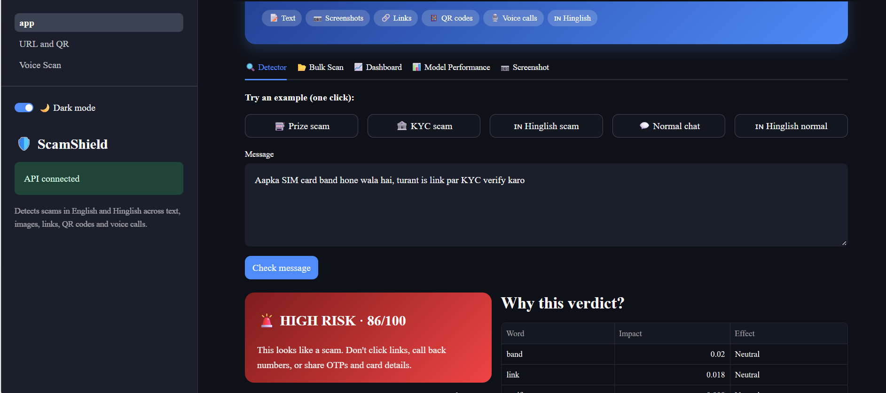
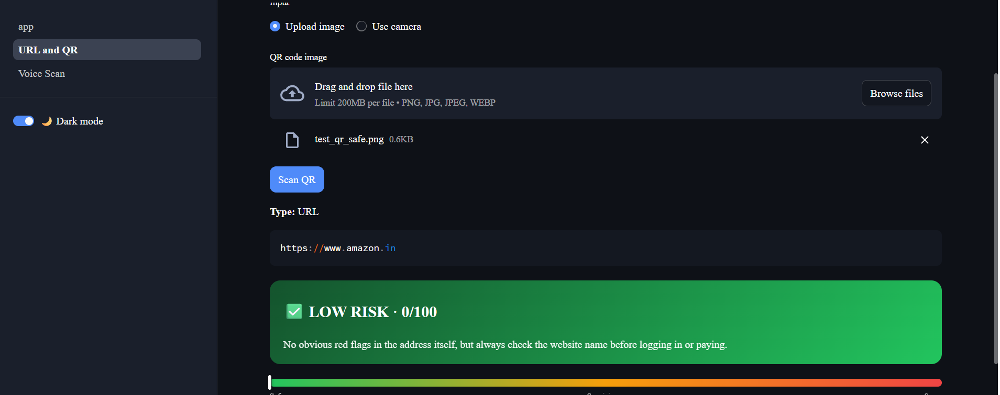
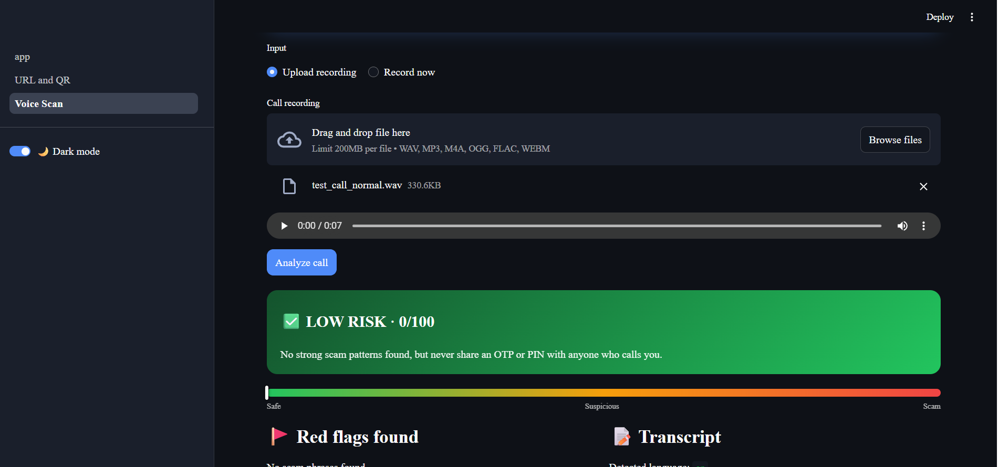
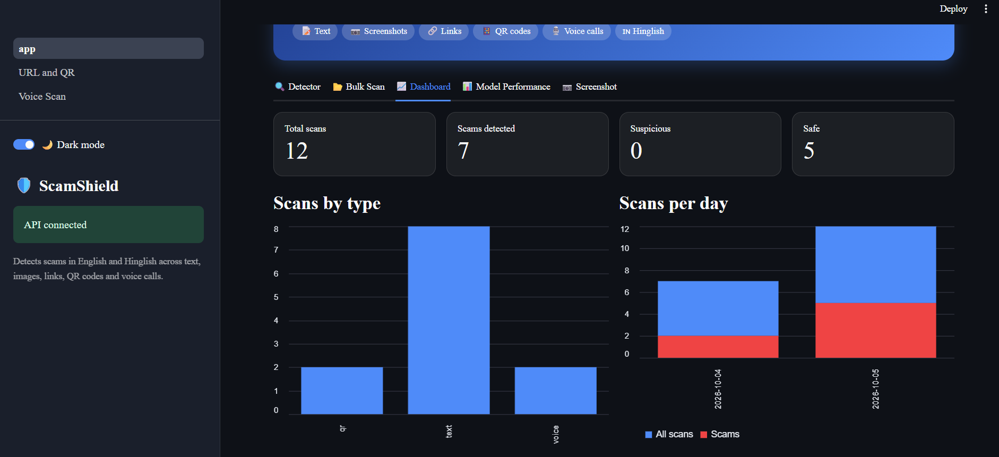
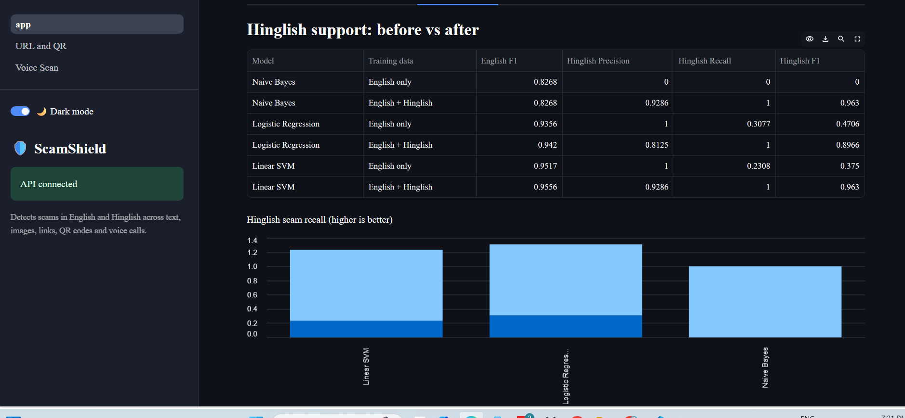
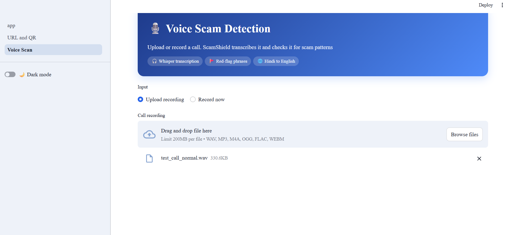
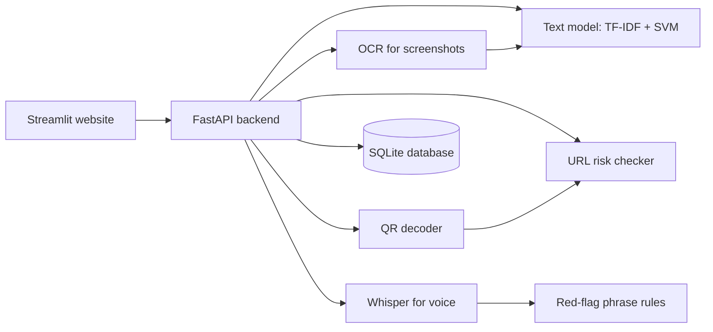

# 🛡️ ScamShield

Real-time scam detection for **messages, screenshots, links, QR codes and phone calls**, with support for **English and Hinglish**.

ScamShield is a full system rather than a single script: one FastAPI backend holds the models, and a Streamlit website uses it.

**Author:** Saniya Raut

## Features

| Feature | How it works |
|---|---|
| 📝 Text detector | TF-IDF + SVM trained on 5,500+ real SMS messages plus Hinglish examples, with a word-level "why this verdict" explanation |
| 🇮🇳 Hinglish support | Roman-script Hindi scams such as "KYC expire ho gaya, abhi update karo" |
| 📷 Screenshot scanner | OCR reads text from a chat screenshot, then the text model checks it |
| 🔗 Link checker | Rule-based risk scoring: lookalike brands, risky endings, shorteners, raw IPs, suspicious words |
| 📱 QR scanner | Decodes the QR code and checks the link, with a special warning for UPI payment QR codes |
| 🎙️ Voice call detection | Whisper transcribes the call (Hindi is translated to English), then the model and red-flag phrases (OTP requests, remote-access apps, fake arrest threats) score it |
| 📈 Dashboard | Every scan is saved in SQLite: counts, scans per day, top scam words, history download |
| 🌙 Dark / light mode | Toggle in the sidebar |

## Screenshots








## Architecture



## Setup

```bash
git clone https://github.com/YOUR_USERNAME/scamshield.git
cd scamshield
pip install -r requirements.txt
```

The trained model (`spam_model.pkl`) is included. To retrain it:

```bash
python download_data.py
python train.py
```

## Run

Open two terminals in the project folder.

**Terminal 1: backend**
```powershell
$env:WHISPER_MODEL="tiny"
uvicorn api:app --reload
```

**Terminal 2: website**
```bash
streamlit run app.py
```

Then open http://localhost:8501. API docs are at http://127.0.0.1:8000/docs.

The first voice analysis downloads the Whisper model, which takes a minute or two and needs internet. `tiny` is fast and fine for English. For better Hindi results, use `small`.

## Test data

```bash
python make_qr.py      # sample scam, safe and UPI QR codes
python make_audio.py   # sample scam and normal call recordings (Windows)
```

## Project structure

```
api.py          FastAPI backend (all endpoints)
app.py          Streamlit website
pages/          URL & QR scanner, voice scan, how it works
train.py        trains and compares the models
hinglish_data.py  Hinglish training examples
urlcheck.py     link and QR risk scoring
voicecheck.py   call transcript scoring
db.py           SQLite logging and stats
style.py        theme, banner and risk cards
```

## Results

Paste the output of this command here, inside a code block:

```bash
python -c "import pandas as pd; print(pd.read_csv('results.csv').to_string(index=False))"
```

`results_hinglish.csv` holds the before-and-after comparison for Hinglish.

## Limitations

- The Hinglish data is small and hand-written, so Hinglish results are a proof of concept, not a benchmark.
- The link checker uses rules. It does not check live blacklists or domain age.
- Call analysis depends on transcript quality, and Hindi translation is weaker on small Whisper models.
- Hinglish is supported in Roman script only.

## Privacy

Everything runs on your own computer. Audio is processed locally and not stored. Only the first 300 characters of each scan are saved in `scamshield.db`, which is not uploaded to GitHub.

## Disclaimer

An educational project. It can make mistakes, so never rely on it alone. Banks and police never ask for an OTP or PIN on a call. Report cyber fraud at cybercrime.gov.in or call 1930.